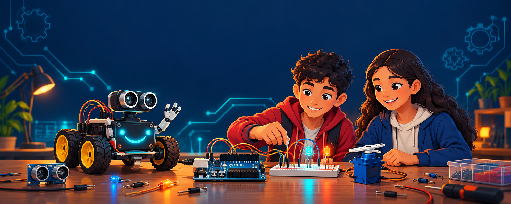
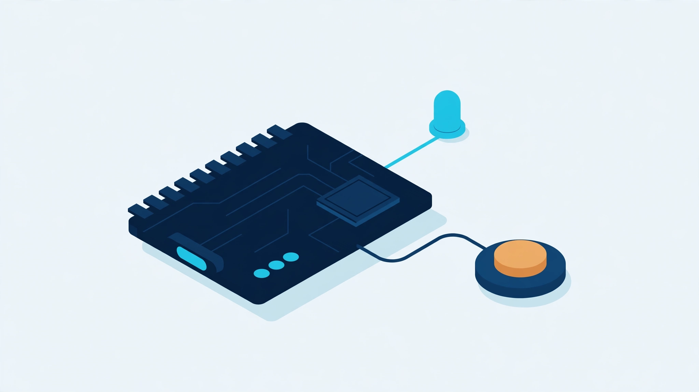
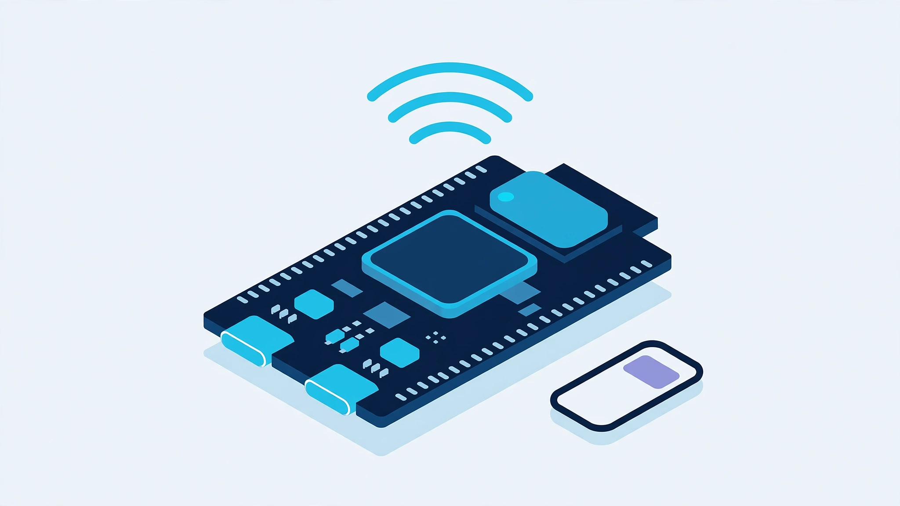
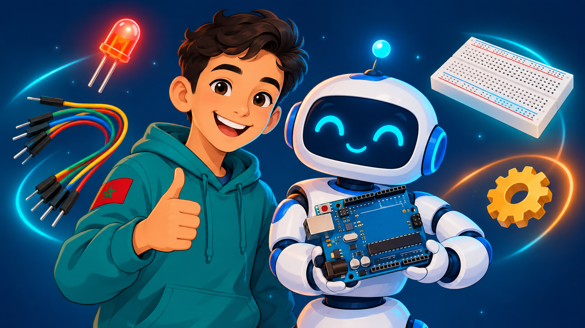
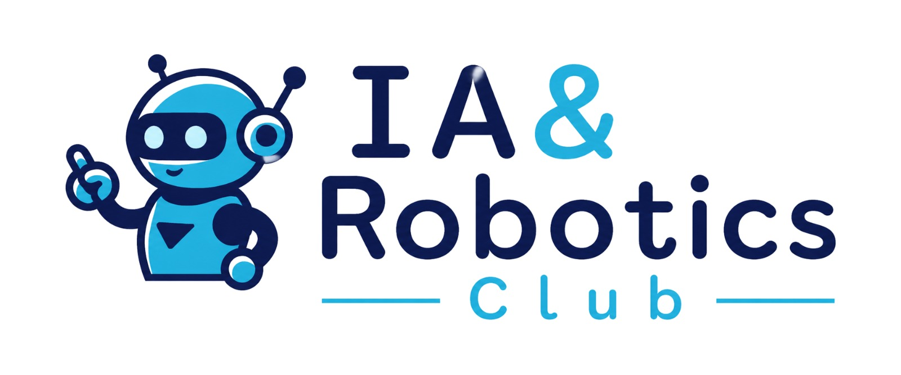
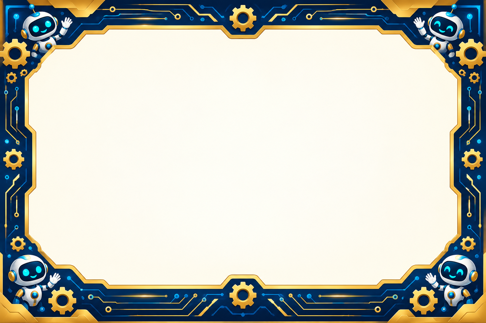

# 🎓 Arduino Academy — أكاديمية الأردوينو

### منصّة عربية متكاملة لتعلّم الأردوينو والروبوتيك — من أول صمّام ضوئي إلى أول روبوت

**45 درسًا بالفيديو • 5 مستويات • تجارب تفاعلية • اختبارات فورية • شهادة لكل مستوى**

---

## 📖 عن المنصّة

**Arduino Academy** منصّة تعليمية عربية موجّهة لتلاميذ الإعدادي والثانوي، تُعلّم برمجة **Arduino C++** داخل برنامج Arduino IDE خطوة بخطوة: من التعرف على اللوحة وإضاءة أول LED، مرورًا بالحساسات والمشغّلات، وصولًا إلى مشاريع روبوتات كاملة ولوحة **ESP32** المتقدمة.

صُمّمت المنصّة لتكون **Offline-First**: تُحمّل مرة واحدة كملف مضغوط، وتعمل بعدها **بالكامل دون أي اتصال بالإنترنت** — مثالية لقاعات الحاسوب المدرسية والنوادي.

## ✨ المميزات

- 🎬 **45 درسًا بالفيديو** بصوت معلّم وشرائح بصور حقيقية للمكوّنات والتوصيلات.
- 🗺️ **5 مستويات متدرجة** من الانطلاقة حتى ESP32 المتقدم.
- 🧪 **تجربة تفاعلية داخل كل درس** بصيغة: توقّع ← غيّر ← لاحظ ← فسّر.
- ✅ **اختبار QCM لكل درس** بتصحيح فوري — ولا يُحتسب الدرس منجزًا إلا باجتياز الاختبار (3/4 على الأقل).
- 🏆 **شهادة إتمام لكل مستوى** قابلة للطباعة باسم التلميذ.
- 👤 **حسابات محلية للتلاميذ** وحفظ تلقائي للتقدم على نفس الحاسوب.
- 📊 **لوحة المعلّم**: استيراد نسخ التلاميذ الاحتياطية، جدول جماعي، وتصدير CSV.
- 💾 **نسخ احتياطي واسترداد** كاملين (تصدير/استيراد JSON) + مفتاح معلّم USB لاسترداد كلمات السر.
- 🔄 **مزامنة اختيارية** عبر Google Drive لمن يتوفر على حسابات Cloud — المنصّة تعمل دونها تمامًا.

## 🗺️ المستويات الخمسة

| المستوى | العنوان | الدروس |
|---|---|---|
|  | **المستوى 1 — الانطلاقة** | 10 دروس |
|  | **المستوى 2 — التحكم والقرارات** | 11 درسًا |
|  | **المستوى 3 — الحساسات والمشغّلات** | 11 درسًا |
|  | **المستوى 4 — مشاريع الروبوتات** | 8 دروس |
|  | **المستوى 5 — ESP32 المتقدم** | 5 دروس |

## 🚀 طريقة الاستعمال

### عبر الإنترنت
افتح رابط **GitHub Pages** الخاص بالمشروع (في قسم About أعلاه) وابدأ مباشرة من المتصفح.

### دون اتصال (الطريقة الأساسية)
1. حمّل مجلد المنصّة كاملًا.
2. افتح ملف `index.html` في أي متصفح حديث.
3. أنشئ حسابك المحلي وابدأ التعلّم — لا حاجة لأي خادم أو اتصال.

> ⚠️ التقدم يُحفظ في متصفح الحاسوب نفسه (localStorage)؛ مسح بيانات المتصفح يمسح التقدم — استعمل النسخ الاحتياطي بانتظام.

## 🛠️ التقنيات

HTML + CSS + JavaScript خالصة (Vanilla) — بلا مكتبات خارجية وبلا أي اعتماد على الشبكة في النواة. اتجاه RTL كامل، وخطوط عربية واضحة، وتجربة متجاوبة مع الحاسوب واللوحة.

## 🤝 الاعتمادات

- **من إعداد الأستاذ محمد الغوات**
- برعاية **نادي الذكاء الاصطناعي والروبوتيك — IA & Robotics Club**، ثانوية الوحدة الإعدادية، إقليم الدريوش، المغرب.
- التكوين **مجاني** لتلاميذ الروبوتيك بإقليم الدريوش حتى نهاية سنة 2026 (يصبح مدفوعًا ابتداءً من 1 يناير 2027).

---

**Arduino Academy — تعلّم بالممارسة، خطوة بخطوة 🤖**

